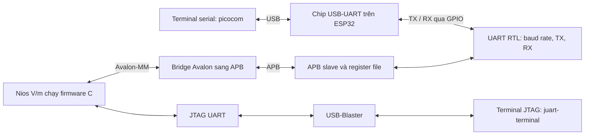

# UART trên FPGA DE2-115 với CPU Nios V

Bản hiện tại đã có **baud lập trình được và interrupt UART**. Chat nhận RX bằng
ISR, TX hoàn tất bằng IRQ; đổi baud qua lệnh JTAG `:baud 9600`.
Hướng dẫn đầy đủ, register map và giới hạn kiểm chứng:
[BAUD_INTERRUPT.md](docs/BAUD_INTERRUPT.md). Sau khi đổi baud FPGA, phải đổi
baud của picocom; script hỗ trợ `terminal_uart.sh /dev/ttyUSB0 9600`.


Project triển khai UART bằng Verilog trên kit **DE2-115 (Cyclone IV E)**,
điều khiển bằng firmware C chạy trên **Nios V/m**. Máy tính sử dụng chip
USB-UART có sẵn trên board ESP32 để giao tiếp với UART của FPGA.

Có hai chương trình C:

- **Echo/chat:** nhập dòng ở một terminal, nhấn Enter mới chuyển cả dòng sang
  terminal còn lại. Hỗ trợ cả chiều JTAG → UART và UART → JTAG.
- **Scope:** tự phát chuỗi `hello`, chờ khoảng 100 ms sau mỗi chuỗi rồi lặp lại,
  dùng để quan sát tín hiệu bằng oscilloscope. Không thêm CR/LF hoặc byte NUL.

UART mặc định: **115200 baud, 8 data bits, no parity, 1 stop bit (8N1)**.

## Kiến trúc hệ thống



ESP32 được dùng làm bộ chuyển USB-UART; CPU ESP32 được giữ reset và không
chạy firmware chuyển tiếp. Hai terminal trong VS Code có vai trò khác nhau:
picocom gửi/nhận qua UART vật lý, còn juart-terminal gửi/nhận qua JTAG UART.

## Cấu trúc thư mục

| Thư mục / file | Nội dung |
|---|---|
| `rtl/` | Các khối UART, APB và bridge |
| `fpga/` | Project Quartus, top-level, pin mapping và script tạo/nạp hệ thống |
| `firmware/main.c` | Chat hai chiều theo dòng (Enter để gửi) |
| `firmware/dti_uart.c` | Driver truy cập thanh ghi UART |
| `firmware/examples/scope_main.c` | Chương trình phát `hello` để đo sóng |
| `tb/`, `sim/` | Testbench và script mô phỏng |

## Điều kiện chạy

Hướng dẫn giả định FPGA, ESP32, dây TX/RX/GND, jumper và driver USB đã được
thiết lập đúng; kit bật nguồn và công tắc RUN/PROG ở **RUN**.
Máy đã có Quartus 25.1std, Nios V tools, RiscFree RISC-V GCC, license Nios V/m,
picocom và Python/pyserial. Questa chỉ cần khi chạy mô phỏng CPU.

**Tất cả lệnh dưới đây chạy tại thư mục chứa README này** — thư mục `UART/`
có các thư mục con `fpga/`, `firmware/`, `rtl/`.

Đường dẫn bộ công cụ được cấu hình trong `fpga/scripts/env.sh`. Khi dùng máy
khác, đặt `UART_QUARTUS_ROOT`, `UART_RISCFREE_ROOT` và `UART_NIOSV_LICENSE_FILE`
theo cài đặt của máy trước khi chạy script. Dùng license cấp cho máy của bạn.

## 1. Compile FPGA và firmware echo

Lần đầu, hoặc sau khi clone repository:

```bash
# Tạo hệ thống Platform Designer và compile FPGA thành file .sof.
bash fpga/build.sh all

# Tạo BSP, project C và build firmware echo thành file .elf.
bash firmware/build.sh all echo
```

Khi hệ thống đã được generate và chỉ cần compile lại:

```bash
bash fpga/build.sh compile
bash firmware/build.sh compile echo
```

Nếu đổi cấu trúc hệ thống Platform Designer, dùng lại các lệnh `all`.
Nếu chỉ sửa C, chỉ cần build firmware; không cần compile Quartus.

File đầu ra:

- FPGA: `fpga/build/output_files/de2_115_uart.sof`.
- Firmware echo: `firmware/build/app/build/uart_firmware.elf`.

Build FPGA phải vượt kiểm tra timing và license, tạo
`fpga/build/HARDWARE_BUILD_READY.txt`. Script nạp còn kiểm tra checksum để
tránh dùng bản build không khớp source hiện tại.

## 2. Nạp kit

Không cần mở giao diện Quartus hoặc file `.qpf` trước khi chạy script.

```bash
source fpga/scripts/env.sh
jtagconfig

# Cable 1, FPGA ở vị trí 1 trong chuỗi Quartus, firmware echo.
bash UART/fpga/program.sh 1 1 echo
```

Script nạp `.sof`, sau đó tải `.elf` vào RAM và chạy CPU. 

## 3. Mở hai terminal trong VS Code

**Terminal 1 — nhập/nhận dòng qua JTAG và USB-Blaster:**

```
bash UART/firmware/terminal_jtag.sh -c 1 -d 0
```

**Terminal 2 — giao tiếp UART qua ESP32:**
Lenh Permission
```sudo chmod a+rw /dev/ttyUSB0```
```bash
python3 -m serial.tools.list_ports -v
bash UART/firmware/terminal_uart.sh /dev/ttyUSB0
```

Thay `/dev/ttyUSB0` bằng cổng USB-UART thực tế. Script picocom đặt 115200 8N1,
tắt flow control và local echo; Enter gửi CR+LF. Firmware tự echo ký tự về
terminal đang gõ, chỉ chuyển sang terminal bên kia khi Enter. Không bật thêm
local echo trong picocom vì sẽ bị lặp ký tự.

Terminal 2 hiện bọc picocom bằng lớp hiển thị lỗi UART và byte không in được;
đổi baud trực tiếp bằng Ctrl+A → Ctrl+B → nhập baud → Enter. Xem
[hiển thị lỗi khi khác baud](docs/UART_ERROR_DISPLAY.md) để cập nhật SOF/ELF
và hiểu ý nghĩa các marker lỗi.

Mỗi dòng tối đa 120 byte; Backspace sửa dòng đang nhập. CR, LF và CR+LF được
chuẩn hóa thành đúng một CR+LF để không thụt cột hoặc chèn dòng trống. Ví dụ
gõ `abc` ở terminal 1: terminal 2 chưa hiện gì; nhấn Enter thì terminal 2
hiện `abc` và con trỏ trở về đầu dòng kế tiếp. Chiều ngược lại tương tự.
Dòng quá dài bị bỏ đến Enter và LED lỗi sáng. Chế độ này dành cho nhập văn bản;
không phải đường truyền byte nhị phân trong suốt.


## 4. Phát hello để đo oscilloscope

```bash
bash UART/firmware/build.sh all scope
bash UART/fpga/program.sh 1 1 scope
```

Firmware tự phát 5 byte `68 65 6C 6C 6F` rồi chờ khoảng 100 ms. Picocom nhận
`hellohello...`; chế độ này không echo RX và không in log JTAG.

Đo tại **GPIO[0] / UART_TX**, mass nối GND kit. Chọn trigger cạnh xuống,
khoảng 1,5 V; timebase 100 µs/div để xem cả chuỗi hoặc 10 µs/div để xem từng
frame. Dữ liệu UART truyền bit thấp trước, idle/stop ở mức cao.

Để quay lại echo:

```bash
bash UART/firmware/build.sh compile echo
bash UART/fpga/program.sh 1 1 echo
```

Chi tiết thêm: [firmware](firmware/README.md), [cấu hình kit và chân FPGA](fpga/README.md),
[kết quả kiểm thử](firmware/VALIDATION.md).

## FIFO phần cứng TX/RX

Mỗi chiều có FIFO 16 byte; TX còn có một byte active. Firmware chat nạp TX theo
đợt tối đa 16 byte, RX giữ parity riêng cho từng byte và có cờ overrun.
Giữ nguyên thao tác Enter gửi dòng, CRLF và hai terminal. Xem
[thiết kế FIFO, register map và cách cập nhật kit](docs/FIFO.md).
